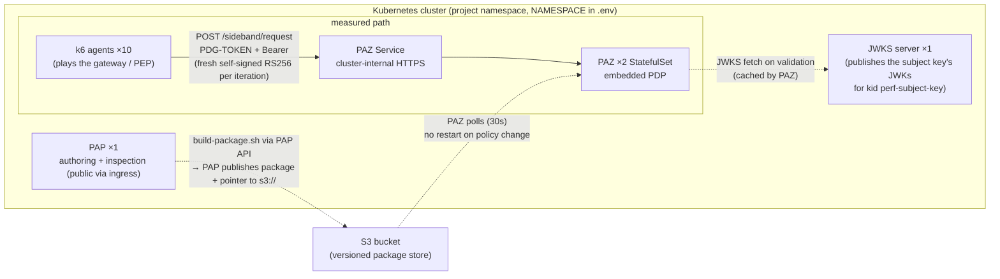

# PAZ sideband decision-path performance test

This project measures the performance of PingAuthorize Server (PAZ) acting as
the Policy Decision Point behind an API gateway, in Kubernetes. The load
generator plays the gateway's role (the Policy Enforcement Point): k6 agent
pods build the Sideband API request envelope exactly as a gateway integration
does and POST it to PAZ's `/sideband/request`, one authorization decision per
call. The campaign reports decision latency (avg/median/p90/p95/p99), achieved
throughput, error rate, and PAZ pod CPU/memory at fixed reference load levels
of 500, 1000, 1500, and 2000 decisions per second.

The deployment under test runs PAZ in **deployment-package (embedded PDP)
mode**: the policy state from a specific, versioned commit is exported as an
immutable bundle and loaded into the PAZ process itself. This is the
production integration model, and it differs from PingAuthorize's
external-PDP mode, in which PAZ resolves policies through PAP
on every decision. In this stack PAP exists only to build
the package once and sits off the decision path entirely.

## Architecture



What is deliberately absent: no API gateway, no adapter, and
no ingress in front of the PDP (the measured path keeps its cluster-internal
Service). PAP is the one exposed workload — the policy administrator's
inspection surface, via the cluster's nginx-public ingress with a
cert-issued TLS host. Token validation is JWKS-based: the PAZ wrapper
chart deploys a JWKS server that publishes the subject key's JWK set from
an in-cluster endpoint (`<release>-jwks`), PAZ fetches and caches it
(issuer-publishes/verifier-fetches), and that fetch-plus-cache sits on
the measured path. Policy delivery is production-shaped:
PAP authors the policy, `build-package.sh` publishes the immutable package
through PAP's package-store API to a private, versioned S3 bucket (PAP
writes both the package object and the pointer file, exactly as the
Deployment Manager's Publish action does), and the PAZ nodes poll and load
it without a restart — the same machinery an S3-backed production
deployment runs. The
policies are a real MCP-gateway policy branch (`AgentGatewayPortfolioMCP`),
packaged as-is, so the measured decisions exercise the real policy ladder
(audience gate, agent-identity delegation, VIP check, scope check) rather
than a permit-all stub.

## The policy under test and the traffic mix

The measured decisions come from the `AgentGatewayPortfolioMCP` policy
branch (a snapshot of a working MCP-gateway authorization policy), imported
into PAP verbatim
(`server-profiles/pingauthorizepap/policies/AgentGatewayPortfolioMCP.SNAPSHOT`)
and published to PAZ as an immutable package rooted at the branch's Global
Decision Point. Under the `AgentGateway` service, the `Portfolio MCP` policy
set holds six policies, each a rule ladder over the JWT's claims (audience,
acting-agent identity, VIP-user claim, scope) and the MCP request body:

1. **Allow Session Methods** — MCP session methods (initialize / tools/list
   / ping): R1 audience gate, R2 delegated-agent identity, R3 VIP-user
   claim, R4 token-active.
2. **Allow Read Tools** — the read-permit path: the same R1–R3 ladder plus
   R4 `portfolio:read` scope; the cheapest full ladder on the tree.
3. **Deny Unpriceable Orders** — a single guard rule.
4. **Allow Orders with HITL Approval** — R1–R3 plus R4 `portfolio:write`
   scope and the approval-binding rule, which mirrors the order body
   (customerId / symbol / side / quantity / amount / txn) one-to-one against
   the token's `tctx` block; the most expensive ladder on the tree.
5. **Deny Oversized Orders** — a single guard rule (amount above the
   `Order Approval Threshold` constant).
6. **Default Deny** — the fallback verdict.

Load is distributed at three layers. Across the generator: the target rate
splits evenly over the ten k6 agent pods (RATE/10 per agent, enforced by
`distributeRate`, which fails the run loudly when the split drifts more
than 5%). Within each agent: the per-agent rate splits into four
ramped-arrival scenarios that map onto the policy paths above — nominally
60% reads (policy 2), 15% session methods (policy 1), 15% HITL orders
(policy 4), and 10% expected denials, which rotate through four negative
fixtures (undeclared acting agent and missing `act.sub` → R2, oversized
order → policy 5, wrong audience → R1) and so walk the ladder to a deny
verdict. Denials take the split remainder so the four rates always sum to
the agent rate; because each scenario's rate is an integer, the nominal
mix rounds to these **configured plateau shares per level**:

| Level | read | session | HITL | deny |
|---|---:|---:|---:|---:|
| 500/s (50/agent) | 60% | 16% | 16% | 8% |
| 1000/s (100/agent) | 60% | 15% | 15% | 10% |
| 1500/s (150/agent) | 60% | 15.33% | 15.33% | 9.33% |
| 2000/s (200/agent) | 60% | 15% | 15% | 10% |

The delivered per-scenario request counts in every counted run match
these shares. Across the server: the ten agents
POST to the cluster-internal PAZ Service, which load-balances across the
two StatefulSet pods.

## Scope of this campaign

The campaign is a **baseline characterization** of the sideband decision path
in deployment-package mode at fixed reference levels up to **2000
decisions/second**. The
results support no conclusions about: the saturation point or maximum
sustainable throughput (no level is run to failure — the cluster is shared
with workloads this project does not own; 2000/s is the campaign bound,
where PAZ sat at a whole-run 1,866 m mean-of-medians of its 4,000 m
per-pod CPU limit (47%) with a still-smooth latency curve); behavior
above 2000/s; overload, burst, failure, or recovery
behavior; autoscaling (the PAZ topology is fixed at two pods); or a
comparison against external-PDP mode (this campaign measures
deployment-package mode only).

## Test environment and sizing

The campaign ran on a shared Kubernetes cluster of six `r5.xlarge` worker
nodes (4 vCPU / 32 GiB each; 3,400m allocatable CPU per node after system
reservations — 20.4 vCPU cluster-wide). The PAZ pods carried lab sizing of
2 CPU / 3 GiB **requests** against 4 CPU / 6 GiB **limits**, one pod per
node: each PAZ pod requests 2 CPUs on a node with 3.4 allocatable vCPUs,
so together the two pods request 4 CPUs across 6.8 allocatable vCPUs;
their combined CPU limits total 8 CPUs, and limits do not reserve
capacity. PAP, the package-authoring surface, carried
1 CPU / 2 GiB requests and 2 / 4 GiB limits and is idle during runs. The
ten k6 agent pods **requested** 500m CPU each with a 4 CPU limit, and a
required anti-affinity term kept every agent off the two PAZ nodes. The
reference results are figures for this environment: two PAZ pods sized at
half their CPU limit, a generator that requests ~15% of a node's
allocatable CPU per agent (500m of 3,400m) but may burst well beyond it,
and co-tenant workloads present but off the PAZ nodes. Node
inventory and pod-to-node placement for every run are recorded in
`results/<run_id>/env.json`.

## Measurement protocol

- Each reference level is run **three times per campaign**, in ascending
  rounds (500 → 1000 → 1500 → 2000, repeated three times). The reference
  table reports the **median run** of the three, selected by measured p95,
  with the per-run p95s quoted alongside it.
- The benchmark applies **no performance acceptance criteria**: no p95
  bound, no success-rate floor, no achieved-rate floor, no verdict. There
  is no performance SLA to encode, and a completed experiment that shows
  poor performance is still a useful result. The reports are descriptive:
  measurements plus explicit collection observations and limitations.
  Missing evidence renders as "unavailable" — never a favorable default.
- A throwaway sanity run (the `agents` profile at the `.env` default rate)
  precedes the campaign: it proves the full collection path — pod
  launch, acknowledgment-based collection, exit-code capture, report
  generation — before any counted run, and warms the PAZ pods after a
  fresh deployment. Sanity runs are never counted in the reference table.
- **The measurement window is the whole run, including the ramp** — the
  generator emits no phase filtering by design (the phase tags remain on
  every request, so a phase-scoped view can be computed from the raw
  streams later, but the published figures pool all samples). Every
  latency column in a run's `summary.json` pools raw per-request datapoints
  across all ten agents; percentiles are nearest-rank order statistics
  over the pooled samples (never averages of agent percentiles).
- Each run: ten parallel k6 agent pods, each driving RATE/10 through four
  ramped-arrival scenarios (read/session/HITL/deny at the campaign's
  weighted mix) that ramp 0→full rate over 30 s and then hold for
  5 minutes. The ramp replaces the constant-arrival step start, which
  stalled PAZ at every 2026-11-16 stage-2000 attempt (see the VU-sizing
  note under Step 2).
- **Each agent writes three artifacts**: the NDJSON metric stream
  (`agent-N-metrics.json`, every raw sample), k6's structured end-of-run
  summary (`agent-N-summary.json`, via `--summary-export` — the source for
  request/drop/error totals), and an exit-code sentinel
  (`/out/k6-exit-code`, written when k6 exits; the runner also records the
  pod's terminal exit code in `env.json`). The report never extracts
  measurement values from text logs.
- **Correctness is measured per request against the policy path under
  test**: permits for the permit fixtures, denials carrying each deny
  fixture's expected embedded status (403 for the delegation and
  oversized-order fixtures, 401 for the wrong-audience fixture), and a
  three-way classification (permit / deny / error) that keeps transport
  failures and malformed responses out of the decision statistics. The
  report shows expected-outcome percentage always, and the classified
  errors and incorrect decisions columns appear when the run captured the
  outcome samples to compute them (they are absent, not zero, otherwise).
- CPU columns come from the 15 s-cadence in-run sampler
  (`usage-during-run.txt`, written by `run-in-cluster.sh`), clipped to the
  observed traffic interval and **including the ramp** (consistent with
  the whole-run window). The median is per pod — each PAZ replica's median
  is reported separately in `summary.json` and in the report's CPU table.
- **Reports compute no verdict and parse no logs.** The generator reads
  env.json, the raw streams, the structured summaries, and the sampler
  output; everything else in the report is computed from those. It also
  records per-agent first/last response timestamps, observed response
  span, malformed-record counts, and a flat `limitations` list in
  `summary.json` — the collection-observation layer that replaces gating;
  the HTML distills the list into its Notes block.
- Server-side ground truth: an end-of-run scrape of PAZ's `cn=Monitor` Gateway
  Timing providers (best-effort — a scrape failure never invalidates a run).
- **The k6 script and report tooling are frozen for the campaign.** Any
  change to the load shape or measurement between counted runs makes runs
  incomparable; tooling changes happen between campaigns, never
  mid-ladder (the 2026-11-16 phase-tag bug — a scenario-level tag that
  blinded the stream parser to every measured datapoint — is the cautionary
  example).

## Repository layout

```
helm/paz/            One configuration chart for the whole Ping stack: values for
                     the official pingidentity/ping-devops chart (0.15.0, tag 2607),
                     one release carrying PAP (public ingress, inspection surface)
                     and 2 PAZ replicas (cluster-internal, ephemeral /opt/out,
                     lab sizing requests 2 CPU/3Gi, limits 4/6Gi).
helm/loadtest/       The k6 agent chart: an indexed Job, N parallel agent pods,
                     each running files/sideband-decision.js with files/envelope.mjs.
server-profiles/     The PAZ dsconfig layer (JWKS token validator,
                     embedded-PDP Policy Decision Service, sideband endpoint)
                     and the PAP profile (snapshot import hook). See
                     server-profiles/README.md — including the version-specific
                     verifications to fill in on first deploy.
profiles/            Load profiles: stage-500/1000/1500/2000.env (the campaign
                     ladder) and agents.env. Each fully describes its run.
scripts/             One script per step: setup-aws (one-time S3 entities),
                     create-secrets, deploy (phases: headroom/prep/package/
                     runtime), verify, build-package, smoke, run-in-cluster,
                     monitor, scrape-monitor, generate-report.py,
                     analyze-run.py, analyze-timeline.py, validate,
                     uninstall.
keys/                Subject signing key (git-ignored). The matching public
                     JWK is published by the chart's JWKS server
                     (generated by scripts/generate-jwks.sh from the key).
results/             Per-run working artifacts, one directory per run (lab-
                     local, not in version control).
reports/             The published HTML reports — the reviewer-facing layer,
                     written automatically by generate-report.py.
.env                 Lab credentials and endpoints — git-ignored (see
                     .env.example for the documented shape).
```

## Quick start

Every command runs on your workstation, from the project root. Nothing is run
by hand inside the cluster. The namespace comes from `NAMESPACE` in `.env`
(any namespace works; use one sized for the stack per the table above).

### Step 0 — one-time setup

1. Provision the chart's licensing secret the way your environment
   standardly does (the chart secretRefs `devops-secret`; this project's
   scripts never touch credentials). Every script auto-creates `.env` from
   the committed defaults on first use; all its values ship with working
   lab defaults.
2. Push this repository to a Git remote the cluster can reach (the Ping
   products clone their server profile from `SERVER_PROFILE_URL` in `.env`
   at boot): `gh repo create <your-org>/<repo> --public --source . --push`,
   then set `SERVER_PROFILE_URL` in `.env` to that remote's clone URL.

The deploy needs nothing else: `create-secrets.sh` (inside `deploy.sh`)
builds the chart's TLS secrets and the `paz-secrets`/`paz-s3`/`paz-loadtest`
Secrets from `.env` (the chart's `devops-secret` licensing Secret is the
operator's to provision). PAP's admin password is the lab constant in
`.env` (`PAP_ADMIN_PASSWORD`, the DevOps default the images boot with);
scripts use it to authenticate against PAP client-side.

### Step 1 — deploy everything to test-ready (~15 minutes)

```bash
./scripts/deploy.sh headroom   # optional: per-node capacity picture first
./scripts/deploy.sh            # everything: secrets, the whole stack (one
                               # release: PAP + 2 PAZ replicas), publish the
                               # policy package through PAP, wait until both
                               # PAZ nodes load it from the store, smoke-test
                               # the three go/no-go decisions
```

The command ends when the stack is Ready, the package is loaded by both
replicas, and smoke passed 3/3 — at that point the only remaining step is
triggering the campaign itself (Step 2). Re-running `./scripts/deploy.sh`
at any time is safe: secrets and the helm release upgrade in place, the
package publish creates a fresh package, and the PAZ nodes pick it up
without a restart.

On first deploy, fill in the three version-specific verifications in
`server-profiles/README.md` (in-container paths, dsconfig property spelling,
monitor providers) — the deploy output prints what each needs.

The deploy's final smoke step runs the go/no-go itself (a valid token with
rotated `sub` → permit; a garbage token → a 200 carrying a 401 denial, so
the validator is proven live; a second rotated token → permit). To re-run
it alone later:

```bash
kubectl -n ${NAMESPACE} port-forward pod/${PAZ_RELEASE}-pingauthorize-0 18443:1443 &
./scripts/smoke.sh
```

### Step 2 — run the campaign (two terminals)

```bash
# Terminal A (optional troubleshooting) — continuous pod/node CPU CSV into
# results/; the report does NOT consume this file (the per-run CPU evidence
# comes from the in-run sampler inside run-in-cluster.sh):
./scripts/monitor.sh

# Terminal B — sanity run, then the ladder, three ascending rounds:
PROFILE=agents ./scripts/run-in-cluster.sh    # sanity run (never counted)
PROFILE=stage-500 ./scripts/run-in-cluster.sh
PROFILE=stage-1000 ./scripts/run-in-cluster.sh
PROFILE=stage-1500 ./scripts/run-in-cluster.sh
PROFILE=stage-2000 ./scripts/run-in-cluster.sh
# ...repeat the ladder twice more (rounds 2 and 3)
```

Never run a level above the 2000/s bound. Each run saves the per-agent
metric streams and structured k6 summaries, `env.json` (with per-agent
exit codes), the in-run CPU sampler output, and the `cn=Monitor` scrape
into `results/<run_id>/`; the runner exits non-zero when the Job fails,
an agent pod ends non-zero, or collection is incomplete — the benchmark
applies no performance thresholds.

#### VU sizing — how the extended levels were tuned (2026-11-16, design note)

The 1500/s and 2000/s levels required tuning the per-scenario VU knobs
(`PRE_ALLOCATED_VUS`, `MAX_VUS` in the stage profiles) because of how the
generator and PAZ interact at the warmup→measured transition. With
`constant-arrival-rate` scenarios, the measured window opens at full rate
in one step, and that burst of fresh TLS handshakes stalls PAZ at the
boundary (observed 2026-11-16: 8 s on a warmed JVM, 22 s on one restarted
minutes earlier), which cascades into VU-pool exhaustion and shed
iterations. Three concrete findings from that investigation's streams:
pre-allocating 300 VUs per scenario made the transition stampede 15,000
VUs deep and PAZ's liveness probes killed it — so do NOT raise
`PRE_ALLOCATED_VUS` toward `MAX_VUS`; a burst of 5,000 stalled it 8 s;
and the same rate in steady state never stalled once load was flowing.

The working configuration is baked into the profiles and the k6 script:
`MAX_VUS=300` at 200 it/s per agent (arrival-rate × a ~1.4 s worst-case
iteration needs that headroom; at 240 the pool shed ~200 iterations),
small `PRE_ALLOCATED_VUS` (the transition burst must stay under what PAZ
absorbs — 50 per scenario at 2000/s), and `ramping-arrival-rate` measured
scenarios that ramp 0→full over the warmup window so no step burst exists
at all. The campaign of record ran this configuration with zero dropped
iterations at every level and a smooth latency curve throughout.

### Step 3 — report

```bash
python3 scripts/generate-report.py <run_id>   # or a run-directory path
```

The generator is deliberately small (standard library only, no log
parsing, no verdicts). It reads `env.json`, the raw metric streams
(`agent-N-metrics.json[.gz]`), k6's structured summaries
(`agent-N-summary.json`), and the run-local sampler output, and writes:

- `results/<run_id>/report.html` — whole-run tables (requests observed vs
  the plateau target, whole-run average throughput, and — when a
  structured summary is present — dropped iterations; combined and
  per-scenario and per-agent latency with expected-outcome percentage,
  plus errors and incorrect decisions as columns only when measured;
  the full-call elapsed section only when that metric was captured;
  per-pod CPU/memory), throughput and latency-over-time charts, separate
  PAZ and generator CPU charts, and a Notes block that consolidates
  whatever instrumentation this run lacked (real collection
  discrepancies, if any, get their own section).
- `results/<run_id>/summary.json` — the machine-readable layer: per-agent
  artifacts (exit code, structured-summary presence, first/last response
  timestamps, malformed-record counts) and statistics, per-scenario and
  overall latency/correctness statistics (raw-sample pooled, nearest-rank
  percentiles), expected-vs-observed volume for a linear ramp, per-pod
  CPU medians with sample counts and `cpu_source`, and the flat
  `limitations` list.
- `reports/<run_id>.html` — the published copy of the report, written
  automatically on every generation so the reviewer-facing layer can never
  drift from the run data.

## Benchmark assumptions

These assumptions define what the measured numbers mean. They are design
decisions, not accidents — changing any of them changes what the benchmark
measures.

1. **Token validation is JWKS-based, with one static signing key.** Subject
   tokens are self-signed RS256 by k6 (kid `perf-subject-key`) with issuer
   `https://paz-perf-subject` (SUBJECT_ISSUER — the token's `iss` claim).
   PAZ's JWT validator (PerfSubjectJWT) resolves the issuer to an HTTP
   external server and fetches the public key set from that server's
   endpoint: the PAZ wrapper chart (helm/paz/templates) deploys a separate
   JWKS server pod (`<release>-jwks`), which publishes the JWK document at
   `http://<release>-jwks/.well-known/jwks.json`; PAZ fetches and caches
   it. The fetch and cache are on the measured path; key *rotation* is not
   exercised (the campaign signs every token with the same static key).
2. **No persistent-store work on the decision path.** PAZ runs standalone
   with an embedded store and ephemeral data; the measured decisions evaluate
   the in-process policy package and touch no user store. The S3 package
   store's poller is active (30 s cadence) exactly as in a production store
   deployment — a background scan whose cost is part of the measured system.
   Subject identity rotates through 100 synthetic VIP users, and PAZ keeps no
   per-subject state on this path, so 100 hot identities exercise the same
   code paths as a cold population. **Token uniqueness:** `jti` includes the
   run id, agent index, full VU id, scenario, and iteration (fixed after
   the 2026-11-17 reviews found an earlier composition could collide within
   one second across agents and across VUs sharing a wrapped user index).
   The campaign of record (2026-11-18) ran with the fixed composition.
3. **The envelope is the production envelope.** The load generator builds the
   sideband request exactly as a gateway-side extAuthz adapter does
   (the envelope schema is pinned by unit tests against that adapter's
   shape). The measured traffic is a weighted
   policy mix — nominally 60% reads, 15% MCP session methods (top-level
   jsonrpc), 15% HITL order approvals, and 10% expected denials per agent
   rate (exact per-level shares in the traffic-mix section; integer
   rounding shifts the smaller scenarios by up to one request/second) — so
   every measured window exercises all four policy paths, not just the
   cheapest one. The measured hop is the hop a gateway integration adds:
   the sideband request plus PAZ's decision. No gateway, adapter, or MCP
   backend is in the measured path — those would measure additional
   components.
4. **Policy constants are real, not synthetic.** The sideband endpoint's
   service (`AgentGateway`), the MCP audience constant
   (`https://agentgateway-stack-ag.ping-devops.com/mcp/portfolio`), and the
   whole policy ladder come from a real MCP-gateway policy snapshot,
   imported into PAP verbatim (see the policy section above). The measured
   permits exercise the same conditions the gateway's permits do.
5. **Monitor providers stay as deployed, for the whole campaign.** If the
   Gateway Timing providers need enabling, they are enabled once before the
   first counted run and never toggled — every number carries the same
   overhead. No paired on/off runs.
6. **The nodes are shared.** Co-tenant load during a run is an uncontrolled
   environmental factor that the report does not isolate — the report
   shows the PAZ and generator pods' CPU only (per-pod medians and
   per-pod CPU charts; co-tenants on the same nodes would depress the
   PAZ pods' available capacity without appearing anywhere). The
   campaign bound (2000/s) exists because of this; reference levels are
   measured as-is, never driven to failure. The median-of-three protocol
   exists to make residual co-tenant noise visible as run-to-run spread
   rather than hiding it inside a single number.
7. **Warm state.** Ladder stages run sequentially against the same
   deployment; all counted runs are continuously warmed (the PAZ pods had
   been serving production-like traffic continuously before the campaign,
   the pre-campaign sanity run exercised them, and each stage ramps for
   30 s). Cold-start behavior is not characterized.

## Reference results — campaign of 2026-11-18

Twelve counted runs: three ascending rounds of the 500 → 1000 → 1500 →
2000 ladder (23:36 UTC on Nov 17 through 00:58 UTC on Nov 18), captured entirely
by the final instrumentation — per-agent exit codes, k6 structured
summaries, per-request outcome classification with expected embedded
denial statuses, full-call elapsed, and the ack-based collector. Every
counted run shows 100% expected outcomes, zero classified errors, zero
dropped iterations, zero malformed records, an empty `limitations` list,
and request volume within 0.03% of the expected linear-ramp amount. Each
table row is the median run of its level's three, selected by measured
p95; the per-run p95s quoted below the table show run-to-run spread. The
reports issue **no performance verdicts** — the benchmark characterizes
performance at specified loads; no performance SLA exists, so there are
no pass/fail criteria to apply.

Two protocol notes for completeness. First, one throwaway sanity run at
50/s preceded the ladder (10 agents, full collection path) and one
earlier sanity attempt failed outright with DNS-resolution errors — the
deployment still carries the project's pre-rename release name, and that
attempt targeted a Service name that did not exist until the `.env`
release-name fix; the failed attempt's artifacts were discarded, and the
`.env` override now pins both the release names and the sideband URL.
Second, the first ladder round's 500/s and 1000/s runs lost their PAZ
CPU samples to a release-label mismatch in the in-run sampler (fixed
mid-campaign); those two runs were superseded by make-up re-runs of the
same profiles and discarded with the failed sanity attempt, and the
table's 500/s and 1000/s rows are the median of {round 2, round 3,
make-up} — three runs each, all with complete CPU evidence.

**Measurement window: the whole run, including the 30 s ramp.** The
generator deliberately ignores phase tags and pools every raw sample;
request counts and latency figures below therefore describe the ramp
plus the 5-minute plateau, and average throughput sits slightly below
the plateau target by construction (a linear ramp contributes half its
rate on average). Phase-scoped (plateau-only) views remain computable
from the preserved streams; the figures here are the whole-run ones the
report defines.

| Stage | Target rate | Requests (whole run) | avg | median | p90 | p95 | p99 | PAZ CPU/pod | Agent CPU |
|---|---|---:|---:|---:|---:|---:|---:|---:|---:|
| 500/s | 500/s | 157,460 | 1.93 ms | 1.70 ms | 2.48 ms | 3.33 ms | 6.45 ms | 434 m | 175 m |
| 1000/s | 1000/s | 314,960 | 2.29 ms | 1.79 ms | 3.43 ms | 5.03 ms | 10.50 ms | 878 m | 354 m |
| 1500/s | 1500/s | 472,456 | 3.13 ms | 1.92 ms | 5.63 ms | 8.86 ms | 21.07 ms | 1,368 m | 532 m |
| 2000/s | 2000/s | 629,957 | 6.77 ms | 2.73 ms | 15.91 ms | 26.67 ms | 55.69 ms | 1,866 m | 741 m |

Per-run p95s by level: 500/s — 3.02 / 3.33 / 3.40 ms (median run
`20261118005122`); 1000/s — 4.91 / 5.03 / 5.49 ms (median run
`20261118002816`); 1500/s — 8.71 / 8.86 / 10.17 ms (median run
`20261118003521`); 2000/s — 24.48 / 26.67 / 33.10 ms (median run
`20261117234329`). Observed request counts track the expected volume for
a linear ramp (target × (duration + ramp/2)) within 0.03% at every
level. CPU medians are per pod over the whole-run interval from the 15 s
in-run sampler (`cpu_source: usage-during-run.txt` in every summary);
each PAZ replica's median is separate in `summary.json`, and the table
quotes their mean. Exit codes were 0 for all 120 agent pods across the
campaign (`agent_exit_codes` in every run's `env.json`); full-call
elapsed (including connection setup) was captured throughout — at the
2000/s median run it reads avg 6.96 ms / p95 27 ms / p99 56 ms over
629,957 calls.

Measurement definitions, precisely: the latency columns pool every raw
`http_req_duration` datapoint across all ten agents — per-agent
steady-state pooling, not a simultaneous aggregate-load window (agents
start within seconds of each other; the report charts bucket every raw
request timestamp directly against one common absolute-time origin).
Percentiles are nearest-rank order statistics over the pooled samples.
The headline latency is k6's `response.timings.duration` — sending +
waiting + receiving, excluding connection establishment, which
steady-state connection reuse amortizes to each VU's first iterations;
full-call elapsed (including connect) is captured separately as
`sideband_request_elapsed`. Correctness figures come from the per-request
classification — expected-outcome percentage over success samples,
classified errors (transport/malformed), and incorrect decisions
(unexpected verdicts excluding errors) — computed for every request in
every counted run. CPU medians are per pod over the whole-run interval,
quoted as the mean of the two replica medians in the table.

The shape of the ladder: the median decision latency barely moves across
the four levels (1.70 → 1.79 → 1.92 → 2.73 ms through 4× the load), while
the tail bends — p95 grows 8× and p99 8.6× — and PAZ CPU per pod scales
slightly super-linearly with offered rate (2.0× / 3.2× / 4.3× the 500/s
level at 2× / 3× / 4× the rate). This pattern is *consistent with* rising
utilization as the cause (a queueing interpretation), but the campaign
measured no per-replica queue depths, thread pools, GC telemetry, or CPU
throttling, so it remains a hypothesis; the CPU figures alone do not rule
out internal saturation. At the campaign bound the measured 1,866 m
mean-of-medians sits at 47% of the pods' 4-CPU limit — but the pods share
3.4-allocatable-CPU nodes with co-tenants, so the limit is a ceiling, not
a guaranteed capacity: headroom against the *node* is smaller than
headroom against the limit.

## Configuration and safety notes

- `.env` holds credentials and is excluded from Git; profiles hold shape
  settings only, never secrets. `keys/` holds the subject signing key and is
  also excluded. The sideband shared secret is generated once and persisted
  to `.env` so PAZ and k6 always share one value.
- The subject signing key is a fixed demo artifact: one 10-year self-signed
  keypair, the key git-ignored in `keys/` and the derived JWKS document
  committed at `helm/paz/loadtest-jwks/jwks.json` (regenerate it with
  `scripts/generate-jwks.sh` if you ever replace the pair, then redeploy —
  the JWKS server serves the new key set and PAZ's validator fetches it).
- `INSECURE_SKIP_TLS_VERIFY=true` is suitable for the chart's internal
  self-signed TLS during a lab test. Install trusted certificates and set it
  to `false` for a production-like test.
- PAZ runs with ephemeral storage (no PVC) and rebuilds from the profile on
  every start; policy data persists in this repository (server-profiles/)
  and in PAP.

## Cleanup

```bash
./scripts/uninstall.sh              # removes the paz and loadtest releases
./scripts/uninstall.sh --purge-secrets  # also deletes the three Secrets
```

The namespace is retained so credentials and the signing key survive between
campaigns; delete it explicitly (`kubectl delete namespace "${NAMESPACE}"`)
only when nothing in it is needed anymore.
